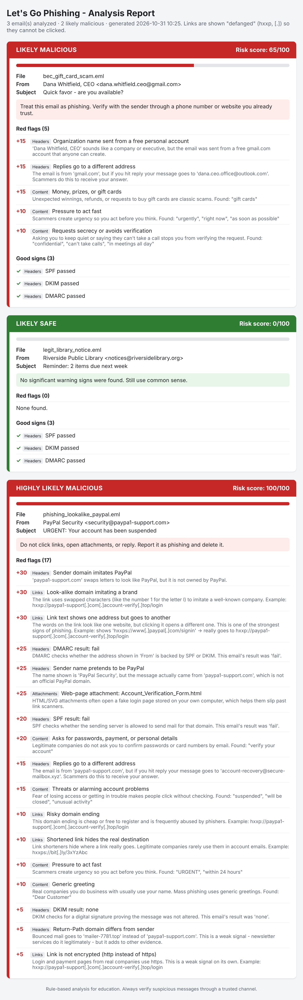

# 🎣 Let's Go Phishing

**A rule-based phishing email detector that inspects headers, links, content and attachments, then gives every email a risk score and a color-coded verdict: 🔴 red for likely malicious, 🟢 green for likely safe.**

Built as part of my cybersecurity student portfolio to understand how phishing works and how defenders spot it.



---

## Why this project?

Phishing is still one of the most common ways attackers get into organizations. Most phishing emails rely on the same small set of tricks: faked senders, deceptive links, and psychological pressure. This tool automates the checklist a security analyst runs through when someone reports a suspicious email, and **explains each finding in plain English** so non-technical users can learn from it too.

## What it checks

| Area | What it looks for |
|---|---|
| **Headers** (the hidden "envelope") | SPF / DKIM / DMARC failures · display name pretending to be a brand · look-alike sender domains (`paypa1.com`) · fake address hidden in the display name · Reply-To sending your answer elsewhere · company or "CEO" names sent from free Gmail/Outlook accounts · mismatched Return-Path |
| **Links** (never visited) | Link text showing one site but going to another · look-alike or brand-borrowing domains · raw IP addresses · the `@` trick · punycode (`xn--`) look-alike characters · URL shorteners · risky domain endings (`.top`, `.xyz`, `.zip`…) · long chains of subdomains · unencrypted `http://` |
| **Content** (social engineering) | Urgency · threats about your account · requests for passwords or payment details · generic greetings ("Dear Customer") · prizes, refunds and gift cards · requests for secrecy · fill-in forms inside the email |
| **Attachments** (names only, never opened) | Programs and scripts (`.exe`, `.js`, `.iso`…) · disguised files (`invoice.pdf.exe`) · macro documents (`.docm`) · HTML/SVG attachments · archives (`.zip`) |

## How the verdict is decided

Each red flag adds points based on how strong a warning sign it is. For example, a deceptive link is worth +30 and an unencrypted link is worth +5. The total is capped at 100:

| Score | Verdict | Color |
|---|---|---|
| 0 – 14 | Likely safe | 🟢 Green |
| 15 – 39 | Probably safe, stay alert | 🟢 Green |
| 40 – 69 | Likely malicious | 🔴 Red |
| 70 – 100 | Highly likely malicious | 🔴 Red |

Passing SPF/DKIM/DMARC is shown as a "good sign" but **adds no safety points**. Those checks only prove an email came from the domain it claims. A scammer using their own Gmail account passes all three, as the included gift-card sample shows.

## Quick start

**Requirements:** Python 3.10 or newer. Nothing else to install; the tool only uses Python's built-in libraries.

1. Download the project:

```bash
git clone https://github.com/AngieConner/Let-s-go-Phishing.git
```

```bash
cd Let-s-go-Phishing
```

2. Analyze the included sample emails (use `python3` on Mac/Linux, `python` on Windows):

```bash
python3 detect.py samples/
```

3. Also create a color-coded web-page report, then open `reports/report.html` in your browser:

```bash
python3 detect.py samples/ --html reports/report.html
```

### Analyzing your own emails

The tool reads `.eml` files, which are saved copies of an email that include the hidden headers.

- **Gmail:** open the email → ⋮ menu → *Download message*
- **Outlook (desktop):** open the email → *File* → *Save As* → choose `.eml` or drag the email to a folder
- **Apple Mail:** select the email → *File* → *Save As* → *Raw Message Source*

Put real emails in a folder named `private/` (it is ignored by Git, so they won't be uploaded), then run:

```bash
python3 detect.py private/
```

## Run the tests

```bash
python3 -m unittest discover -s tests -v
```

## Project structure

```
Let-s-go-Phishing/
├── detect.py                    # The program you run (command-line entry point)
├── phishing_detector/           # The detection engine
│   ├── __init__.py              # Runs the full pipeline: load → check → score
│   ├── email_loader.py          # Opens .eml files; extracts headers, text, links, attachments
│   ├── header_checks.py         # SPF/DKIM/DMARC, spoofed senders, Reply-To tricks
│   ├── link_checks.py           # Deceptive and suspicious links
│   ├── content_checks.py        # Social-engineering language and risky attachments
│   ├── domain_tools.py          # Domain helpers: look-alike detection, defanging
│   ├── scoring.py               # Adds up points and decides red or green
│   └── report.py                # Colored terminal output and HTML report
├── samples/                     # Three fictional test emails (2 malicious, 1 safe)
├── tests/                       # Automated tests
└── docs/                        # Screenshot used in this README
```

## Safety by design

- **Links are never opened.** They are only read as text, so analyzing an email can't trigger a malicious website or tell the attacker your address is active.
- **Attachments are never opened.** Only their file names are inspected.
- **Reports "defang" links** (`hxxp://evil[.]com`) so nobody can click them by accident. This is standard practice in security reports.
- Sample emails use fictional domains and reserved documentation IP addresses (`203.0.113.0/24`, `198.51.100.0/24`).

## Limitations (honest notes)

- It's **rule-based**: a brand-new trick that matches none of the rules can get through, and an unusual but honest email can be flagged (a "false positive").
- It doesn't check live threat-intelligence feeds or domain age, and it doesn't detonate attachments in a sandbox.
- The domain parsing is simplified and doesn't use the full Public Suffix List.
- The brand list is short and English-only.
- It's a learning tool, not a replacement for a professional email security gateway.

## Ideas for future versions

- Look up links and file hashes on VirusTotal or URLhaus (with an API key)
- Check how many days old a sender's domain is (new domains are risky)
- Simple web interface for pasting an email
- A small machine-learning model trained on public phishing datasets, compared against these rules

## Skills demonstrated

Email protocols and header analysis (SPF, DKIM, DMARC) · phishing and social-engineering indicators · URL analysis and IOC defanging · Python (standard library, packages, dataclasses, regular expressions, HTML parsing) · rule-based risk scoring · automated testing · technical writing for non-technical audiences

## Disclaimer

This project is for education and defensive security. Use it only on emails you are allowed to analyze.

---

*Author: Angie Conner, cybersecurity student*
